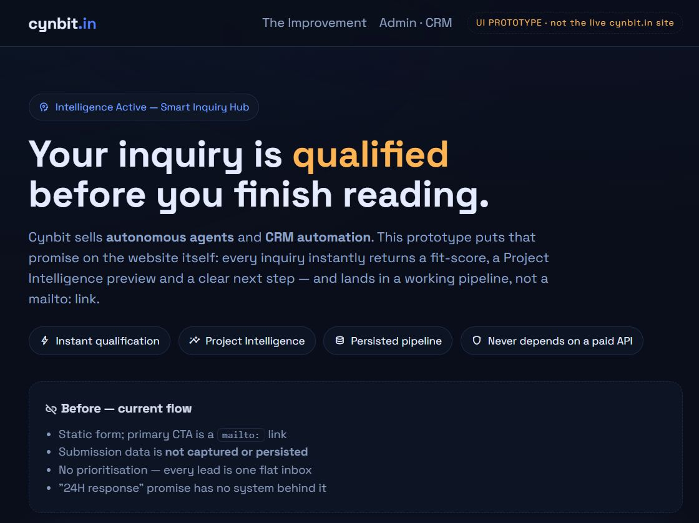
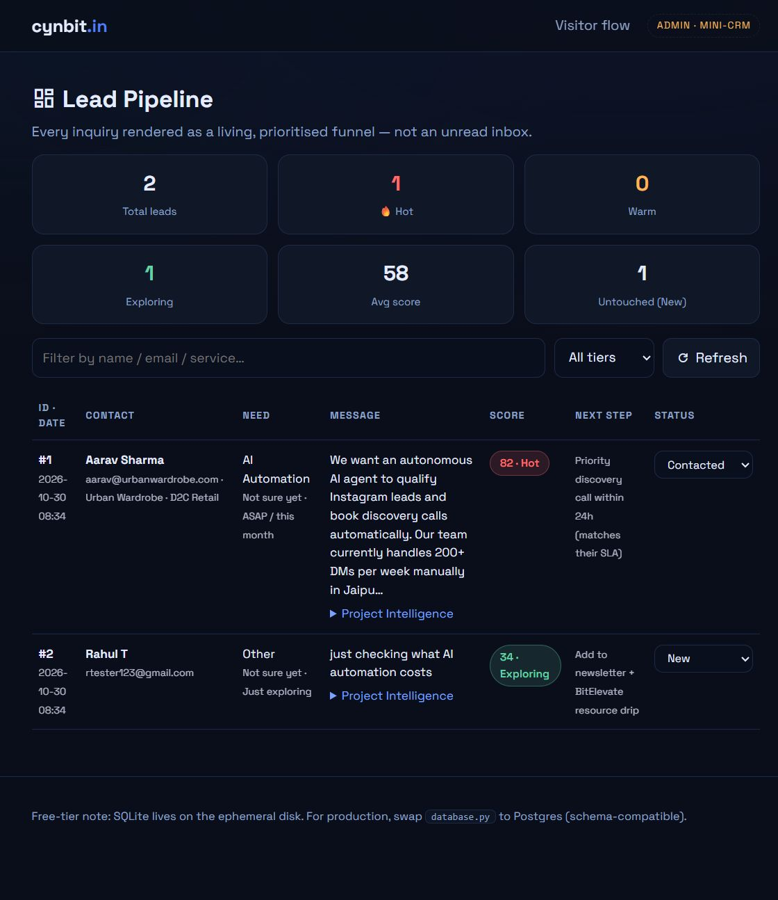

# Cynbit Smart Inquiry Hub

**Full Stack Developer Intern — Task: Improve Cynbit's Website**
Author: Varun Jain (B.Tech CSE, 2027 · Jaipur) · [github.com/varunjain2409](https://github.com/varunjain2409)

**Live prototype:** **`https://cynbit-smart-inquiry-hub.onrender.com`**
**Visitor flow:** `/` · **Admin CRM:** `/admin` · **Health:** `/api/health`

| Visitor flow (improved inquiry hub) | Admin CRM (live pipeline) |
|---|---|
|  |  |

---

## 1. Problem statement

Cynbit Technologies markets itself on autonomous AI agents, CRM automation and funnel
optimisation — yet its own inquiry flow does none of that:

| Cynbit's marketing claim | Reality in the current website |
|---|---|
| *"Autonomous agents that manage leads"* | No agent exists on the site. |
| *"CRM automation — engines that nurture leads"* | The primary CTA on `/contact` is a **mailto:** link. Submissions are not captured anywhere in the product. |
| *"Our team will analyze your requirements and prepare a tailored strategic overview"* | No analysis happens on submission; every lead arrives as one flat, unqualified inbox. |
| *"24H response sync"* | Nothing in the flow prioritises hot prospects, so the SLA has no system behind it. |

From the **developer's** perspective: a form that email-redirects is unmeasurable,
unradiatable and unscorable — the analytics layer ("where did this lead come from,
what does it need, how urgent") simply does not exist.

From the **user's** perspective: a visitor who just drafted a serious project brief
gets a dead end — a blank mail client — and no receipt, no expectation, no feedback.

## 2. The improvement — "Smart Inquiry Hub"

A drop-in replacement for the static inquiry block that makes the website **do what
Cynbit sells**:

1. **Qualified intake** — visitor picks a service track, budget band and timeline;
   server-side validation (strict, typed, error-mapped) before anything is stored.
2. **Explainable lead scoring (0–100)** — deterministic rule engine (no black box):
   brief quality, budget band, timeline urgency, business-vs-personal email domain,
   company/industry completeness, service-vs-message keyword fit. Every point is
   surfaced as a visible signal.
3. **Project Intelligence preview** — auto-generated strategic overview for the
   reviewing team. Rendered by the **rule engine by default** (zero paid deps,
   zero downtime) and auto-upgraded to **GPT-4o mini** when `OPENAI_API_KEY`
   is present — graceful degradation, mirroring the production agent pattern.
4. **Persisted pipeline + Mini-CRM** (`/admin`) — leads land in SQLite with a tier
   (🔥 Hot / Warm / Exploring), a recommended next step, and a status column
   (New → Contacted → Call booked → Won/Lost) the team can drive.

## 3. Technical report

### 3.1 Stack choices

| Layer | Choice | Why |
|---|---|---|
| Backend | **Flask 3 (Python)** | Ruthlessly small surface for a REST + SSR prototype; Cynbit lists Python/FastAPI/Django among its stacks, so endpoints port 1:1. |
| Data | **SQLite** | Zero-config persistence that survives Render deploys long enough to demo; the report notes the one-command Postgres swap for production (`CREATE TABLE` identical). |
| Scoring/AI | **Rule engine + optional OpenAI** | An intake funnel must never go down because an LLM is down. The LLM is an **upgrade**, not a dependency — the same design as the Text-to-SQL pattern. |
| Frontend | **Vanilla JS + fetch, no build step** | The improvement is a widget meant to be embedded in an existing site (theirs uses Next.js); shipping zero build-chain friction makes adoption trivial. |
| Deploy | **Render free tier + `render.yaml` blueprint** | One-command, reproducible deploy with a health check wired in. |

### 3.2 Implementation notes

```
app.py            routes, validation, error contracts (Flask)
lead_engine.py    scoring rules + Project Intelligence (rule-engine fallback / GPT-4o-mini)
database.py       SQLite schema, CRUD, pipeline stats
templates/        index.html (visitor) · admin.html (mini-CRM)
static/           style.css (cynbit-aligned dark UI) · app.js (form logic)
render.yaml       Render blueprint (build/start/health-check)
```

**API contract**

```
POST /api/inquire
  body: { name, email, company?, industry?, service, budget, timeline, message }
  400 → { ok:false, errors: { field: reason } }        (mapped, per-field)
  200 → { ok:true, id, score, tier, next_step,
          intelligence, summary_type, signals[] }

GET  /api/leads          → all leads, newest first
GET  /api/stats          → pipeline totals (hot/warm/exploring/avg score)
POST /api/leads/:id/status → update pipeline status
GET  /api/health         → liveness probe (Render health check)
```

**Scoring model (rule engine)** — baseline 20 + signal points, capped 0–100:

| Signal | Points |
|---|---|
| Brief detail (>120 words / >45 / short) | +14 / +9 / +2 |
| Budget band (₹10L+ → Not sure) | +34 → +6 |
| Timeline urgency (ASAP → exploring) | +24 → +3 |
| Business email domain (vs Gmail/Yahoo…) | +10 / +3 |
| Company / industry provided | +6 / +4 |
| Service↔message keyword fit (hits 1–4) | +4 → +10 |

Tiers: **Hot ≥70** (priority discovery call within 24h) · **Warm ≥45**
(scoping call this week) · **Exploring <45** (nurture + BitElevate resources).

**Anti-patterns avoided:** no data leaves the site (no forced mailto), no unvalidated
submissions, no black-box scoring, no hard dependency on a paid API for core flows,
no client-side-only "demo" — every field of the contract is exercised live.

### 3.3 Results

* A serious brief (3+ paragraph, 2L+ budget, ASAP, corporate email) lands **🔥 Hot**
  with a Priority discovery call recommendation — in seconds.
* A one-line "just exploring" visitor is correctly parked at low score with a
  nurture path instead of polluting a sales inbox.
* **Admin CRM** (`/admin`) renders the pipeline: tier filters, search, live stats,
  per-lead Project Intelligence and status transitions.
* The rule-engine path answers **always**; the LLM path improves it **when available**.

## 4. Run it locally

```bash
pip install -r requirements.txt
python app.py          # http://localhost:5000  (admin at /admin)
```

Optional: `set OPENAI_API_KEY=sk-...` to switch previews to GPT-4o-mini.

## 5. Deploy (Render)

1. New Web Service → pick this repo (Blueprint auto-reads `render.yaml`), **or**
   manual: build `pip install -r requirements.txt`, start
   `gunicorn app:app --bind 0.0.0.0:$PORT`, health path `/api/health`.
2. Open the live URL. Submit an inquiry → check `/admin`.

## 6. Limitations & next steps

- SQLite is fine for a prototype; production = managed Postgres (same SQL).
- Email notifications/integration with a real CRM (via SMTP/SendGrid/webhooks) is a
  small, isolated adapter — deliberately left out to keep zero external dependencies.
- Rate limiting + CAPTCHA before public hardening (honeypot included already).
- The widget is written embeddable-first (`<script>` + iframe mount) so it can be
  injected into cynbit.in without touching their Next.js core.
